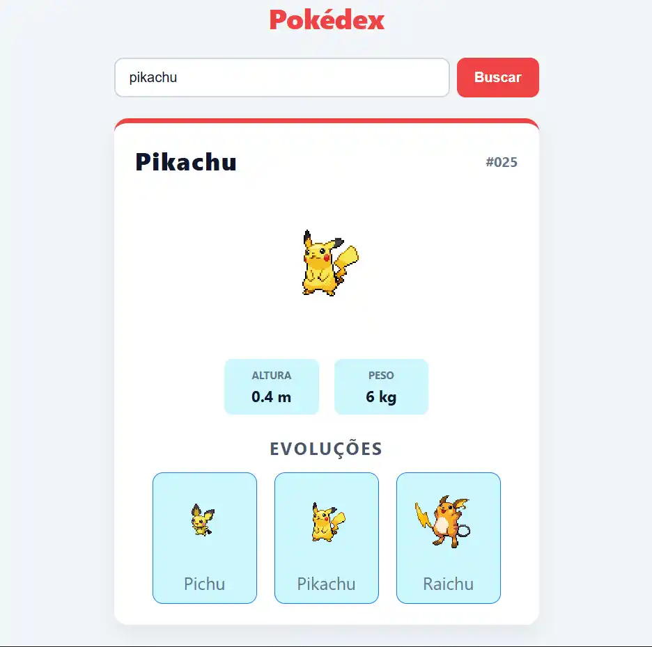

<div align="center">
  
  <h1>Pokédex — React & TypeScript</h1>
  <p>Aplicação web interativa para consulta de Pokémon, atributos físicos e cadeias evolutivas completas em tempo real utilizando a <strong>PokéAPI</strong>.</p>

  <p>
    
    
    
    
  </p>
</div>

---

## 📸 Demonstração

> *Interface exibindo a busca, os dados principais e a cadeia evolutiva carregada dinamicamente.*

<div align="center">
  
</div>

---

## ✨ Funcionalidades

- **Busca Inteligente:** Pesquisa por nome (ex: `pikachu`, `charizard`) ou número da Pokédex (ex: `25`, `150`), com tratamento automático de espaços e letras maiúsculas/minúsculas.
- **Ficha Técnica Completa:** Exibição do sprite oficial, identificador formatado (`#001`), altura convertida para metros (`m`) e peso convertido para quilogramas (`kg`).
- **Cadeia Evolutiva em Paralelo:** Navegação recursiva pela árvore de evolução da espécie e carregamento simultâneo das imagens de cada estágio com `Promise.all`, além de tratamento específico para Pokémon que não evoluem.
- **Feedback de Interface:** Indicadores visuais de carregamento (*loading*) durante as requisições e mensagens claras de erro caso o Pokémon não seja encontrado.

---

## 🏗️ Arquitetura do Projeto

O código foi estruturado separando responsabilidades entre contratos de domínio, camada de serviço (acesso à API) e componentes visuais reutilizáveis:

```text
src/
├── components/
│   ├── EvolutionChain.tsx   # Renderiza os estágios da cadeia evolutiva
│   ├── PokemonCard.tsx      # Card principal com sprite, status e evoluções
│   └── SearchBar.tsx        # Formulário controlado para pesquisa
├── services/
│   └── pokeApi.ts           # Comunicação com a PokéAPI e orquestração com Promise.all
├── types/
│   └── pokemon.ts           # Interfaces de domínio (Pokemon e Evolucao)
├── App.css                  # Estilização e layout responsivo
├── App.tsx                  # Gerenciamento de estados (dados, loading e erro)
└── main.tsx                 # Ponto de entrada da aplicação
```

---

## 🚀 Como Executar Localmente

1. **Clone o repositório:**
   ```bash
   git clone [https://github.com/SamuelSilva-06/pokedex-react.git](https://github.com/SamuelSilva-06/pokedex-react.git)
   ```

2. **Acesse a pasta do projeto:**
   ```bash
   cd pokemon-react
   ```

3. **Instale as dependências:**
   ```bash
   npm install
   ```

4. **Inicie o servidor de desenvolvimento:**
   ```bash
   npm run dev
   ```

5. Abra o navegador no endereço indicado no terminal (geralmente `http://localhost:5173`).

---

## 🛠️ Tecnologias e Conceitos Aplicados

- **React (Hooks):** Gerenciamento de estado e formulários controlados com `useState`.
- **TypeScript:** Tipagem estrita de respostas externas da API e contratos internos da aplicação (`import type`).
- **Consumo de APIs REST:** Encadeamento de múltiplos endpoints (`/pokemon`, `/pokemon-species` e `/evolution-chain`) com `fetch`, `async/await` e `Promise.all`.
- **Vite:** Empacotamento e ambiente de desenvolvimento rápido.

---

## 👨‍💻 Autor

Desenvolvido por **Francisco Samuel**  
[](https://github.com/SamuelSilva-06)